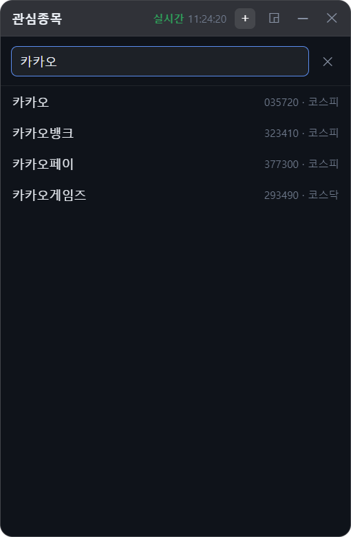

# 한국 주식 관심종목 데스크톱 위젯

화면 위에 항상 떠 있는 프레임리스 반투명 주식 위젯. Electron으로 만들었고 **증권사 계좌 없이** 동작합니다.


## 기능

- 항상 위에 표시되는 프레임리스 반투명 창 (마우스를 올리면 진해짐)
- 관심종목 리스트 → 클릭하면 아래에 차트 표시
- 코스피 · 코스닥 지수를 상단에 함께 표시
- 현재가 · 등락(원/%) · RSI(14) 기반 과열도 5단계
- 시간외(장후)에는 정규장 종가 대비 이동폭을 한 줄 더 표시
- 타임프레임 전환 (1D / 1W / 1M / 3M / 1Y) 및 해당 구간 수익률 표시
- 이동평균선 9종 (5 · 10 · 20 · 40 · 60 · 80 · 120 · 240 · 360일) 중 선택 표시
- 차트 하단에 거래량 막대, 종가 뒤에 고가~저가 밴드
- 3M · 1Y 차트에 지지·저항 추세선 — 오늘 값, 돌파, 수렴까지 남은 거래일 표시
- 보유 종목 전체 평가금액·손익 합계 (달러 종목은 환율로 환산)
- 52주 최저~최고 구간에서 현재가 위치
- **목표가 알림** (선택 기능 — 켜야만 동작)
- 보유 수량·평단가를 넣어두면 평가손익 표시 및 차트에 평단가 점선
- **한글 종목 검색**으로 관심종목 추가/삭제 (국내 주식·ETF + 미국 주식)
- 드래그로 관심종목 순서 변경
- 장중 30초 자동 갱신 (장 마감 후에는 5분으로 자동 완화)
- 우하단으로 접기 / 최소화 / 전역 단축키로 표시·숨김
- 창 위치·크기, 선택 종목, 타임프레임, 관심종목을 저장해 재실행 시 복원

  

## 다운로드

[**⬇ KRStockWidget-Setup.exe 내려받기**](https://github.com/Wuid0801/stock-widget-v1/releases/latest/download/KRStockWidget-Setup.exe) (약 90MB, Windows 10/11 64비트)

> **처음 실행하면 "Windows의 PC 보호" 창이 표시됩니다.**
> 코드 서명 인증서가 없는 빌드라 SmartScreen 이 경고를 띄웁니다. **추가 정보 → 실행**으로 진행할 수 있습니다.
> 배포본 대신 [소스에서 직접 빌드](#직접-빌드하기)해 사용하는 방법도 있습니다.

버전은 [릴리즈 페이지](https://github.com/Wuid0801/stock-widget-v1/releases/latest)와 exe 속성(자세히 → 파일 버전)에서 확인할 수 있습니다.

## 직접 빌드하기

Node.js 18 이상이 필요합니다 (메인 프로세스에서 전역 `fetch`를 씁니다).

```bash
npm install
npm start
```

첫 실행은 화면 중앙에 340×520으로 뜹니다.

### 설치 파일 만들기

```bash
npm run dist    # dist/KRStockWidget-Setup.exe  (약 90MB, 30초)
```

명령은 이것 하나입니다. 아이콘 생성이 안에 포함되어 있어서 `build/icon.svg` 만 고치면 다음 빌드에 자동 반영됩니다.

> **아이콘을 왜 생성하나**
> Windows 는 상황마다 다른 크기를 씁니다 — 제목표시줄 16px, 작업표시줄 32px, 탐색기 48px.
> PNG 를 넘기면 electron-builder 가 256px 한 종류만 넣어서 작은 크기에서 뭉개집니다.
> 그래서 벡터 원본을 16·24·32·48·64·128·256 각각으로 렌더해 멀티사이즈 `.ico` 를 만듭니다
> (`build/make-icon.cjs`, 이미지 라이브러리 없이 Electron 렌더 캡처 + ICO 컨테이너 직접 조립).

> **왜 서명 단계를 꺼두었나**
> electron-builder 는 exe 아이콘을 넣을 때 `winCodeSign` 아카이브를 받아 푸는데,
> 그 안에 macOS 용 심볼릭 링크가 들어 있어 Windows 에서는 개발자 모드나 관리자 권한 없이
> 압축 해제가 실패합니다. 그래서 `win.signAndEditExecutable` 을 끄고,
> 아이콘과 버전 정보는 `build/after-pack.cjs` 에서 `rcedit` 으로 직접 넣습니다.
> 따라서 개발자 모드나 관리자 권한 없이 빌드할 수 있습니다.
>
> 서명되지 않은 exe 라 실행 시 SmartScreen 경고가 뜹니다. 없애려면 코드 서명 인증서가 필요합니다.

## 사용법

| 버튼 | 기능 |
|:---:|---|
| **＋** | 종목 검색·추가 (한글명 또는 6자리 코드) |
| **⚙** | 설정 — 화면(테마·투명도) · 이동평균선 · 목표가 알림 · 보유 종목 |
| **◲** | 우하단으로 접기 (관심종목 3개만) / 다시 누르면 원래대로 |
| **─** | 최소화 |
| **✕** | 종료 |

- **창 이동** — 상단 바 드래그 · **크기 조절** — 창 가장자리 드래그. 창을 세로로 늘리면 차트도 같이 커집니다 (150 ~ 300px)
- **종목 삭제** — 목록 행에 마우스를 올리면 오른쪽에 ✕. 잘못 눌렀으면 아래에 뜨는 **되돌리기**를 6초 안에 누르세요
- **순서 변경** — 목록 행을 드래그해서 원하는 자리에 놓기
- **검색** — `Enter`로 첫 결과 추가, `Esc`로 닫기. 접힌 상태에서 열면 잠시 펼쳐졌다가 닫을 때 다시 접힙니다.

### 단축키

창이 떠 있을 때(검색·설정 패널이 닫힌 상태에서) 씁니다.

| 키 | 동작 |
|---|---|
| `↑` `↓` | 관심종목 이동 (끝에서 반대쪽으로 이어짐) |
| `1` ~ `5` | 타임프레임 — 1D · 1W · 1M · 3M · 1Y |
| `Ctrl+Z` | 방금 지운 종목 되돌리기 |
| `Esc` | 우하단으로 접기 / 펴기 |

전역 단축키(창을 숨겼을 때도 동작)는 별도입니다 — 아래 "전역 단축키" 참고.

### 삭제 되돌리기

목록의 ✕는 관심종목만이 아니라 **직접 입력한 목표가와 보유 수량·평단가까지 함께** 지웁니다. 지운 종목의 설정이 유령처럼 남지 않게 하려는 것이지만, 평단가는 위젯 밖에서 복원되지 않는 값입니다.

그래서 확인 창으로 매번 막는 대신, 지운 뒤 6초 동안 되돌릴 수 있게 했습니다. 되돌리면 **목록에서의 원래 위치까지** 복구합니다. 마지막 하나만 기억합니다.

### 화면 — 테마 · 투명도

⚙ 설정 패널의 "화면"에서 조절합니다. 둘 다 저장돼 재실행 시 유지됩니다.

| 항목 | 값 |
|---|---|
| 테마 | 다크(기본) / 라이트 |
| 투명도 | 30 ~ 100%, 기본 74% |

투명도는 **마우스가 벗어났을 때의 진하기**입니다. 마우스를 올리면 항상 100%가 됩니다.

> 슬라이더를 조절하는 동안에는 커서가 위젯 위에 있어 hover 로 또렷해지기 때문에 효과가 보이지 않습니다.
> 그래서 슬라이더를 만지는 중에는 hover 를 잠시 무시해 실제 진하기를 보여주고, 손을 떼면 원래대로 돌아옵니다.

색은 `index.html` 의 CSS 변수 한 곳에서만 정의하고, 라이트는 `[data-theme="light"]` 에서 값만 갈아끼웁니다. 차트(Chart.js)도 그리는 시점에 같은 변수를 읽어가므로 테마를 바꾸면 축·격자·툴팁까지 따라옵니다. 색을 조정할 때는 그 두 블록만 수정하면 됩니다.

상승 빨강 · 하락 파랑 · 실시간 초록처럼 **뜻을 가진 색은 두 테마에서 동일**하게 유지합니다.

### 목표가 알림

⚙ 설정 패널의 "목표가 알림" 섹션에서 설정합니다. **기본은 꺼져 있고, "사용"을 켜야만 동작합니다.**

- 종목별로 상한 / 하한을 넣어두면 **장중에 그 가격을 통과할 때** Windows 알림이 뜹니다.
- 통과하는 순간에만 한 번 알립니다. 목표가를 넘어선 상태로 머무는 동안에는 다시 울리지 않고, 되돌아왔다가 다시 통과하면 그때 또 알립니다.
- 앱을 켤 때 이미 목표가를 넘겨 있어도 울리지 않습니다 (첫 갱신은 기준만 잡습니다).
- 장 마감 중에는 울리지 않습니다.
- 관심종목을 삭제하면 그 종목의 목표가도 함께 지워집니다.

### 보유 종목 · 평가손익

같은 설정 패널의 "보유 종목" 섹션에 수량과 평단가를 넣으면, 해당 종목을 선택했을 때 상세에 `10주 · 평단 200,000 · 평가 2,310,000 · +310,000 (+15.50%)` 형태로 표시됩니다. 계좌 연동 없이 직접 입력하는 값입니다. 수량과 평단가가 **모두** 있어야 저장됩니다.

평단가는 **차트에도 가로 점선**(`평단`)으로 표시됩니다. 축과 무관하게 캔버스에 직접 그리기 때문에, 평단가가 화면에 보이는 가격 범위를 벗어나면 y축을 늘리는 대신 선을 생략합니다. 데이터셋으로 넣었다면 평단가 5만 원 / 현재가 20만 원인 종목에서 차트가 통째로 눌렸을 겁니다.

### 가로 기준선 · 십자선

- **`평단`** — 보유 평단가 (모든 타임프레임)
- **`전일`** — 전일 종가. **1D 에서만** 그립니다. 일봉 차트에서는 마지막에서 두 번째 점일 뿐이라 기준선이 될 이유가 없습니다.
- **`시간외`** — 시간외 거래 중일 때의 현재가. **1D 에서만.** 헤더의 `시간외` 배지와 같은 색입니다.
- **십자선** — 마우스를 올리면 그 시점에 세로 점선. 툴팁이 잡고 있는 요소를 그대로 써서 표시 위치가 어긋나지 않습니다.

선끼리 10px 안으로 가까워지면 글자가 포개지므로 **선은 그리고 라벨만 생략**합니다.

시간외에는 세 선이 함께 이야기를 만듭니다.

```
전일   ┈┈┈┈┈┈┈┈┈┈┈┈┈┈  268,500
시간외 ┈┈┈┈┈┈┈┈┈┈┈┈┈┈  258,500
        ╱╲╱▔╲
차트 ──────────────────  247,500   ← 정규장이 끝난 자리
```

**왜 봉으로 이어붙이지 않는가.** 세 가지 이유입니다.

1. **시계열이 없습니다.** Naver 는 시간외 현재가 한 점만 줍니다. 15:30 과 지금을 직선으로 잇는 건 없었던 움직임을 그리는 것입니다 — 시간외 단일가는 10분마다 한 번씩 체결되는 불연속 경매입니다.
2. **x축이 카테고리라 시간이 왜곡됩니다.** 모든 점을 같은 간격으로 그리므로 15:30~16:00 의 30분 공백이 5분봉과 같은 폭으로 보입니다.
3. **정규장이 밀려납니다.** 정규장 5분봉 78개에 시간외 12개를 붙이면 정작 중요한 구간이 87% 로 압축됩니다.

직접 시계열을 쌓는 방법도 있지만 앱을 켜둔 구간만 채워지고 화면에 어디가 구멍인지 표시되지 않습니다. 신뢰할 수 없는 선을 그리는 것보다 수준만 정확히 짚는 편이 낫습니다.

### 미국 주식

한글로 검색됩니다 — `엔비디아` → `NVDA`, `애플` → `AAPL`. 국내 종목과 섞어서 담을 수 있고, 통화가 다르면 종목명 옆에 `(USD)`가 붙고 가격이 소수 2자리로 표시됩니다.

| | 국내 | 미국 |
|---|---|---|
| 심볼 | `005930.KS` / `247540.KQ` | `NVDA` (접미사 없음) |
| 시세 | Naver 실시간 → 실패 시 Yahoo | Yahoo |
| 표시 | `231,000` | `218.99` |

> 헤더의 실시간/시간외/장마감 배지는 **국내 시세 소스** 기준입니다. 미국 종목은 Naver 실시간 대상이 아니라 Yahoo 값을 그대로 씁니다.
> 검색 결과는 국내(KOR)와 미국(USA)만 노출합니다. 일본 등 다른 시장은 Yahoo 심볼 접미사를 확신할 수 없어 제외했습니다.

### 전역 단축키

| 단축키 | 동작 |
|---|---|
| `Ctrl` + `Alt` + `S` | 위젯 표시 / 숨김 |

다른 프로그램이 선점한 조합이면 등록에 실패하고 콘솔에 경고만 남습니다. 조합은 `main.js` 의 `TOGGLE_KEY` 에서 변경합니다.

> 작업표시줄에 아이콘이 없는 위젯이라(`skipTaskbar`) **✕ 버튼으로 종료**해야 합니다.
> 최소화하면 그동안만 작업표시줄에 나타나고, 되살리면 다시 숨겨집니다.
> 창을 놓쳤을 때는 위 단축키로 되살릴 수 있습니다.

## 데이터 소스

계좌가 필요 없는 무료 소스만 씁니다. 용도에 따라 두 곳을 나눠 쓰고 있습니다.

| 용도 | 소스 | 비고 |
|---|---|---|
| 현재가 · 등락 | Naver 실시간 | 지연 0초, 다종목 1회 요청 |
| 코스피 · 코스닥 지수 | Naver 실시간 | 두 지수 1회 요청 |
| 차트 시계열 | Yahoo Finance | **한국 시세는 20분 지연**. 1D 30초 · 나머지 5분 캐시 |
| RSI · 이동평균용 일봉 | Yahoo Finance | 5년치(약 1,219봉), 30분 캐시 |
| 52주 최고/최저 | Yahoo Finance | `meta` 에 포함되어 추가 요청 없음 |
| 거래량 · 고가 · 저가 | Yahoo Finance | 차트 응답에 포함되어 추가 요청 없음 |
| 원/달러 환율 | Yahoo Finance | `KRW=X`, 30분 캐시. 보유에 달러 종목이 있을 때만 |
| 종목 검색 | Naver 자동완성 | 주식·ETF 한글 검색 |
| 업종 | Yahoo 검색 | 심볼당 1회, 세션 캐시. ETF 는 값 없음 |

### 왜 나눠 쓰는가

- **Yahoo 한국 시세는 20분 지연입니다.** 실측 결과 세 종목 모두 기준시각이 정확히 20분 전이었고, 삼성전자 기준 3,250원(1.4%) 차이가 났습니다. 그래서 현재가만 Naver 실시간으로 덮어씁니다.
- **Yahoo 검색은 한글 쿼리에 HTTP 400을 반환합니다.** `query1`/`query2`/`lang` 지정/`autocomplete` 모두 실패해서 검색은 Naver를 씁니다.
- **차트·RSI는 Yahoo를 유지합니다.** RSI 는 일봉 종가 기반이라 20분 지연의 영향이 거의 없고(마지막 종가만 현재가로 치환), 비공식 API 의존도를 낮추기 위해서입니다.

### 업종

종목명 옆에 회색 작은 글씨로 붙습니다. **Yahoo 값을 영어 그대로** 씁니다.

```
삼성전자 · Consumer Electronics
```

Yahoo 의 `quoteSummary`(assetProfile)는 크럼 토큰을 요구해 `Invalid Crumb` 으로 막히는데, **검색 엔드포인트에 심볼을 넣으면 인증 없이** `sector` · `industry` 를 같이 줍니다. 검색이라 엉뚱한 종목이 1등으로 올 수 있어 **심볼이 정확히 일치할 때만** 씁니다.

번역하지 않으므로 11개짜리 `sector` 대신 **150개가 넘는 `industry`** 를 씁니다. `sector` 로는 삼성전자·SK하이닉스가 똑같이 `Technology` 인데, `industry` 로는 `Consumer Electronics` 와 `Semiconductors` 로 갈립니다. `industry` 가 없으면 `sector` 로 내려갑니다.

업종은 바뀌지 않으므로 세션 캐시에 담습니다. 값이 없는 경우(`null`)도 캐시합니다 — ETF 를 볼 때마다 다시 묻지 않기 위해서입니다. 조회 실패만 캐시하지 않습니다.

> **거래소 업종이 아닙니다.** Yahoo 는 GICS 기준이라 삼성전자가 `Consumer Electronics` 로 애플과 같은 칸에 들어갑니다. 한국거래소 기준으로는 "전기/전자" 입니다.

실측 커버리지 (2026-08-26):

| 종목 | quoteType | 표시 |
|---|---|---|
| 삼성전자 | EQUITY | Consumer Electronics |
| SK하이닉스 | EQUITY | Semiconductors |
| 알테오젠 (코스닥) | EQUITY | Biotechnology |
| Apple | EQUITY | Consumer Electronics |
| KODEX 200 | **ETF** | (비움) |

영어라 길어질 수 있어(`Semiconductor Equipment & Materials`) 이름 줄을 `text-overflow: ellipsis` 로 자릅니다. 안 자르면 등락률이 오른쪽으로 밀려납니다.

### 폴백

Naver 실시간 조회에 실패하면 자동으로 Yahoo 값(20분 지연)으로 떨어집니다. 헤더에 어느 쪽인지 항상 표시합니다.

- 초록 `실시간` — Naver 실시간 시세 (정규장, 30초 갱신)
- 파랑 `시간외` — 정규장은 끝났지만 시간외 거래가 진행 중 (30초 갱신 유지)
- 회색 `장마감` — 모든 세션이 끝나 값이 고정된 상태 (갱신 주기를 5분으로 늦춤)
- 주황 `20분지연` — Naver 실패, Yahoo로 동작 중

### 시간외 거래

국내 종목은 **정규장이 끝난 뒤에도 시간외 가격을 따라갑니다.**

정규장 종가만 보면 실제와 크게 어긋납니다. 17:24 KST 실측에서 삼성전자 정규장 종가는 247,500이었지만 시간외에서는 258,500에 거래되고 있었습니다 — 11,000원(4.4%) 차이입니다.

Naver 응답의 `overMarketPriceInfo` 에 이미 들어있는 값이라 **추가 요청이 없습니다.**

```
marketStatus: CLOSE                    ← 정규장 종료
closePriceRaw: 247,500
overMarketPriceInfo: {
  overMarketStatus: 'OPEN',            ← 시간외 진행 중
  overPrice: '258,500',                ← 이 값을 현재가로 쓴다
  compareToPreviousClosePrice: '-10,000'
}
```

- 등락률 기준은 **전일 종가**입니다 (Naver 가 주는 기준 그대로). 정규장 종가 대비가 아닙니다.
- 그래서 **정규장 종가 대비 이동폭을 한 줄 더** 붙입니다. 등락 두 줄 아래, 시간외 기준선과 같은 색입니다.

  ```
  -7,000        ← 전일 종가 대비 (Naver 기준)
  -0.38%
  종가 -4,000    ← 정규장 종가 대비 = 시간외에서 실제로 움직인 폭
  ```

  2026-09-10 17:31 실측입니다. SK하이닉스 정규장 종가 1,853,000 → 시간외 1,849,000 이므로 시간외에서 움직인 건 -4,000 인데, Naver 가 주는 -7,000 은 전일 종가 1,856,000 기준입니다. 두 숫자가 다 필요해서 둘 다 둡니다.

  **장후(`AFTER_MARKET`)에만 뜹니다.** 장전 시간외에서는 그때의 "종가"가 곧 전일 종가라 바로 위 줄과 같은 숫자가 되어 내지 않습니다. 시각을 하드코딩하지 않고 Naver 의 `tradingSessionType` 을 그대로 따르므로, 거래 시간이 바뀌어도 코드는 그대로입니다.
- 시간외에도 **갱신 주기 30초를 유지**하고 **목표가 알림도 동작합니다.** 이전에는 정규장이 끝나면 5분으로 늘어나 시간외 돌파를 놓쳤습니다.
- 1D 차트는 정규장 5분봉만 그리고, 시간외 현재가는 `시간외` 가로 기준선으로 표시합니다 (위 "가로 기준선 · 십자선" 참고).
- 종목마다 시간외 개시 여부가 다를 수 있습니다. 각 종목은 자기 최신 가격을 보여주고, 배지는 하나라도 시간외면 `시간외`로 표시합니다.

**미국 주식은 정규장만 봅니다.** Yahoo 의 `regularMarketPrice` 를 쓰고 있어 프리마켓·애프터마켓이 빠집니다.

> 시간외 단일가는 거래량이 얇아 가격이 쉽게 튑니다. 정규장 종가와 같은 무게로 보지 마세요.

> Naver 엔드포인트는 **공개 문서가 없는 비공식 API**라 예고 없이 막히거나 형식이 바뀔 수 있습니다.
> 그래서 실패해도 앱이 멈추지 않도록 폴백을 넣었습니다. 매매 판단 용도로는 적합하지 않습니다
> (호가 잔량·체결 단위 데이터가 없고, 폴링 방식이라 구조적으로 스냅샷만 봅니다).
> 안정성이 필요하면 [한국투자증권 KIS Developers](https://apiportal.koreainvestment.com/apiservice)
> 같은 공식 API 로 교체할 수 있습니다. 계좌와 앱키가 필요한 대신 REST/WebSocket 이라 Electron 에서 그대로 사용할 수 있습니다.

### 타임프레임 매핑

| 버튼 | range | interval |
|---|---|---|
| 1D | `1d` | `5m` |
| 1W | `5d` | `30m` |
| 1M | `1mo` | `1d` |
| 3M | `3mo` | `1d` |
| 1Y | `1y` | `1d` |

Yahoo의 1D 봉은 20분 전에서 끊기므로, 장중에는 현재가를 끝점으로 이어붙여 차트 끝과 표시 가격이 어긋나지 않게 합니다.

1D 외의 탭에서는 상단 등락(일간)과 별도로 **해당 구간의 수익률 배지**(`1Y +230.50%`)를 함께 보여줍니다. 1D는 일간 등락과 같은 값이라 표시하지 않습니다.

### 이동평균선

**5 · 10 · 20 · 40 · 60 · 80 · 120 · 240 · 360일** 중 원하는 것만 골라 그립니다. ⚙ 설정 패널의 "이동평균선"에서 칩을 눌러 켜고 끄며, 선택은 저장됩니다. 기본값은 `5 · 20 · 60` 입니다 — 9개를 한꺼번에 그리면 작은 차트에서 서로 겹쳐 읽기 어렵기 때문입니다.

일봉 타임프레임(**1M · 3M · 1Y**)에만 표시합니다. 1D(5분봉)·1W(30분봉)에 "5일선"을 그리면 이름과 실제가 맞지 않기 때문입니다.

**보고 있는 구간에 비해 너무 긴 기간은 자동으로 빠집니다.** 켜 둔 상태라도 그 타임프레임에서는 그리지 않고, 설정의 칩이 흐리게 표시됩니다. 더 긴 타임프레임으로 바꾸면 다시 나타납니다.

| 타임프레임 | 봉 수 | 그려지는 기간 |
|---|---:|---|
| 1M | 약 22 | 5 · 10 · 20 |
| 3M | 약 66 | 5 · 10 · 20 · 40 · 60 · 80 |
| 1Y | 약 243 | 전부 |

y축이 모든 선을 담도록 늘어나기 때문입니다. 1M 차트의 360일선은 8개월 전 평균이라 거의 수평선인데, y축만 크게 벌려 정작 주가 움직임을 눌러버립니다. 삼성전자 기준으로 1M 차트에서 9개를 모두 그리면 주가가 세로의 **39%**만 차지하지만, 구간에 맞는 3개만 그리면 **69%**가 됩니다.

주가선은 2px·불투명, 이동평균은 1px(20 · 40 · 80은 1.2px)·불투명도 80%입니다. 색이 아니라 굵기로 주가선이 먼저 읽히게 한 것이라, 이동평균을 진하게 해도 위계가 유지됩니다. 주가선 아래 채움도 아래쪽을 옅게 해서 이동평균이 지나갈 자리를 비웠습니다.

범례(`5■ 20■ 60■`)는 타임프레임 버튼 아래에 오른쪽 정렬로 붙습니다. 차트 안에 두면 9개일 때 두 줄로 늘어나 150px 중 35px 가까이 잡아먹기 때문입니다. 실제로 그려진 선만 나옵니다.

**차트에 마우스를 올리면 범례에 그 시점의 값이 들어갑니다** (`5 71,340■`). 툴팁에 넣지 않는 이유는 툴팁이 켠 이동평균 수만큼 세로로 늘어나기 때문입니다 — 9개면 약 197px 로 150px 짜리 차트를 통째로 덮었습니다. 툴팁은 날짜·주가·거래량 3줄로 고정하고, 이동평균 값은 차트 밖 범례가 받습니다. 값이 비어 있을 때도 자리를 유지해서, 마우스를 올릴 때 범례가 접히며 차트가 들썩이지 않습니다.

> **왜 일봉을 5년치나 받는가**
> 이동평균은 차트 구간보다 앞선 과거가 있어야 첫 점부터 그려집니다.
> 1Y 차트(243봉)에 360일선을 끝까지 그리려면 앞으로 360봉이 더 필요해 최소 603봉이 있어야 합니다.
> 1년치(243봉)로는 5일선조차 전 구간을 채우지 못하고, 2년치(484봉)로도 360일선은 모자랍니다.
> 그래서 5년치(약 1,219봉)를 받습니다.
>
> 5년치는 종목당 약 80KB라 30초마다 받으면 낭비입니다. 일봉은 장중에 마지막 봉만 움직이므로
> **30분 캐시**하고, 현재가는 Naver 실시간에서 따로 받아 덮어씁니다. 화면 갱신 주기는 그대로 30초입니다.
> Naver 조회가 실패해 Yahoo 로 폴백한 동안에는 가격도 일봉에서 오므로 캐시를 1분으로 줄입니다.

### 거래량

차트 하단에 막대로 표시합니다. 전용 y축의 최댓값을 거래량 최댓값의 4배로 잡아 **아래 1/4만** 쓰게 했고, 주가선·이동평균선보다 뒤에 그립니다. 툴팁에는 `거래량 1,234만` 형태로 주가 바로 밑에 붙습니다.

### 고가~저가 밴드

종가 라인 뒤에 그날의 고가~저가를 옅은 띠로 깝니다. 종가만 그리면 하루에 얼마나 흔들렸는지가 안 보이기 때문입니다 — 삼성전자 어느 날은 281,500~284,500을 오갔지만(3,000원, 1.06%) 종가 라인에는 점 하나로만 찍힙니다. 툴팁에도 `고저 281,500 ~ 284,500` 으로 나옵니다.

거래량과 고가·저가 모두 차트 응답의 `indicators.quote[0]` 안에 종가와 함께 이미 들어있던 값이라 **추가 요청이 없습니다.**

```
quote[0]: open, high, low, close, volume
```

### 지지·저항 추세선

**3M · 1Y 에서만** 저점을 잇는 지지선과 고점을 잇는 저항선을 점선으로 긋습니다. 켜고 끄는 설정은 없습니다.

한정한 이유는 봉 개수입니다. 1M 은 21봉이라 구간이 짧고, 1D · 1W 는 분봉이라 "추세"라고 부를 구간이 아닙니다.

```
1. 최근 5봉을 뺀 나머지 저가(고가)로 볼록 껍질   Andrew monotone chain
2. 껍질에서 가장 긴 선분                        =  추세선 후보
3. 검사 세 개를 통과해야 그린다
4. 빼둔 5봉이 그 선을 뚫었으면 돌파로 표시
```

#### 최근 5봉은 선을 만드는 데 쓰지 않습니다

이게 이 기능의 핵심입니다. **선을 마지막 봉까지의 껍질로 만들면 그 선은 정의상 절대 뚫리지 않습니다.**

볼록 껍질은 넣어준 점을 전부 감싸고, 위쪽 껍질은 기울기가 왼쪽→오른쪽으로 단조 감소합니다. 그래서 어떤 선분을 앞으로 연장해도 그 뒤의 봉은 반드시 연장선 아래에 놓입니다. 마지막 봉까지 넣으면 오늘 고가도 예외가 아닙니다.

결과는 이렇습니다. 하락 저항선이 10,000까지 내려와 있는데 오늘 12,000까지 급등하면, **선이 다시 계산되어 오늘 고가 12,000에 맞춰집니다.** 여전히 "하락 저항선"으로 보이지만 기울기만 완만해졌을 뿐이고, 돌파했다는 사실은 화면에서 사라집니다. 추세선이 알려줄 수 있는 가장 쓸모 있는 정보를 구조적으로 못 말하던 셈입니다.

그래서 **최근 5봉(약 1주)을 껍질에 넣지 않습니다.** 그 봉들은 선을 만드는 데 참여하지 않으므로 선을 뚫을 수 있고, 뚫렸다는 사실을 말할 수 있습니다.

> 이전 판에서 실측표에 적던 `뚫음 0` 은 측정값이 아니라 **항등식**이었습니다. 어떤 데이터를 넣어도 0 이 나옵니다. 성과처럼 읽히던 숫자라 지웠습니다.

#### 검사 세 개

**통과 못 하면 그 선은 그리지 않습니다.**

| 검사 | 기준 | 이유 |
|---|---|---|
| 구간 | 20봉 이상 | 짧은 선분은 최근 두 봉을 이은 것뿐이라 추세가 아님 |
| 연장 거리 | 선분 끝점이 피팅 창 끝에서 10봉 이내 | 오래된 선분을 끝까지 늘이면 엉뚱한 데를 가리킴 |
| 창끝 이격 | 피팅 창 끝에서 선과 실제값 차이 20% 이내 | 0 을 넘더라도 현재가에서 한참 떨어진 선은 정보가 아님 |

**창끝 이격을 왜 "창 끝"에서 재는가.** 현재가와 비교하면 돌파를 걸러냅니다 — 돌파는 주가가 선에서 멀어지는 일이니까요. 반면 피팅 창 끝은 제외 구간 **앞**이라 돌파가 그 값에 섞이지 않습니다. 그래서 거리 기준을 되살려도 돌파는 그대로 보입니다. 실측(2026-09-08 장중, 10종목)에서 실제로 그려지는 선 8개는 |이격| ≤ 6.50% 이고, 급락 시나리오는 36% · 71% 로 사이가 비어 있어 10~30% 어디를 잡아도 결과가 같습니다. 20% 는 관측 최댓값의 약 3배입니다.

> 이 검사는 나중에 덧붙인 것입니다. 처음엔 "현재가 ±10%" 로 재다가 돌파가 걸러져 빼버렸는데, 그때 같이 사라진 보호 장치가 있었습니다. 급락 종목에서 지지선이 **0 이하**를 가리켜 y축 눈금에 음수 가격이 찍혔고(92% 급락에서 오늘값 -1,224), 돌파 판정도 부호가 뒤집혀 이탈이 아닌 봉을 "지지 이탈 +686%" 로 보고했습니다. 0 이하는 아예 거부하고, 나머지는 이 창끝 이격으로 막습니다.

연장 거리 제한은 예전의 "현재가 대비 ±10%" 검사를 대체한 것입니다. ±10% 로는 **돌파를 그대로 걸러내 버립니다** — 돌파하면 선이 현재가에서 멀어지니까요. 원래 막으려던 건 "1Y 저항 +75%" 같은 경우였고, 진짜 원인은 거리가 아니라 **오래된 선분을 멀리까지 연장한 것**이었습니다.

실측으로 재보면 둘이 깨끗하게 갈립니다 (2026-09-08 장중, 6종목 × 3M·1Y):

| 선의 종류 | 연장 거리 |
|---|---|
| 오늘값이 현재가 근처인 멀쩡한 선 | 0 · 0 · 3 · 3 · 4 · 8 · 8 봉 |
| 오늘값이 현재가 대비 +42 ~ +115% 인 엉뚱한 선 | 16 · 16 · 16 · 26 · 39 · 43 · 55 · 56 · 94 봉 |

8봉과 16봉 사이가 비어 있어 **8~15 어디를 잡아도 결과가 같습니다.** 가운데인 10 을 씁니다.

지지선만, 저항선만, **또는 둘 다 없는 상태가 정상입니다.** 안 보이는 것보다 그럴듯한데 틀린 숫자가 나쁘기 때문에, 애매하면 그리지 않는 쪽을 택했습니다.

선은 그 선분의 시작점부터 마지막 봉까지만 그립니다. 뒤로 늘이지 않는 건 화면 밖으로 나가며 y축만 넓히기 때문이고, 앞으로 연장하지 않는 건 카테고리 축에 미래 칸이 없기 때문입니다.

#### 두 가지를 실측으로 바로잡았습니다

**스윙 피벗이 아니라 (피팅 창의) 모든 봉으로 껍질을 쌓습니다.** 처음에는 좌우 n 봉 극값(피벗)만 넣었는데, 피벗이 아닌 봉이 선 아래로 삐져나왔습니다 — 삼성전자 3M 에서 **20봉 중 3봉이 최대 17,871원까지 뚫었습니다.** 껍질이 감싸는 건 넣어준 점들뿐이라, 창 안의 모든 봉을 넣어야 "창 안에서는 뚫리지 않는다"가 성립합니다. 창 밖(최근 5봉)에서 뚫리는 건 의도한 것이고, 그게 돌파입니다.

**마지막 선분이 아니라 가장 긴 선분을 씁니다.** 볼록 껍질은 기울기가 단조라 **마지막 선분이 언제나 가장 가파릅니다.** 그걸 앞으로 연장하니 지지선이 주가 위로 올라갔습니다(기울기 +4,093원/봉, 오늘값이 현재가보다 2,714원 높음). 지지선이 현재가 위에 있으면 이미 뚫린 선입니다.

#### 돌파

빼둔 5봉 중 고가가 저항선 위로(저가가 지지선 아래로) **1% 넘게** 나간 봉이 있으면 배지가 붙습니다.

```
저항 돌파 +8.46% · 1일 전
```

**비율로** 가장 크게 벗어난 봉 하나만 씁니다 — 절대폭으로 고르면 기울기가 급할 때 더 큰 돌파를 놓칩니다(선 19,000 에서 1,200원=6.32% 가 선 11,800 에서 1,000원=8.47% 를 이겨 작은 값이 찍혔습니다). 양쪽이 다 뚫렸으면 더 크게 벗어난 쪽만 보여줍니다 — 폭 340px 에 배지가 셋 이상 들어가면 줄이 접힙니다. **돌파가 있으면 수렴 배지는 뜨지 않습니다.** 한쪽이 이미 끝난 선인데 두 선이 만나는 시점을 말하면 틀린 정보입니다.

1% 문턱이 있는 이유는 껍질이 원래 선에 닿기 때문입니다. 스치는 일이 흔해서, 실측에서 Apple 3M 저가가 지지선을 **0.035%(11센트)** 스쳤습니다. 그대로 두면 배지에 `지지 이탈 +0.04%` 가 찍힙니다. 실제 돌파는 2.60% · 4.16% · 8.46% 로 나와 0.5~2% 어디를 잡아도 같은 결과라 1% 를 씁니다.

> **돌파 표시는 약 1주만 유지됩니다.** 5봉이 지나면 그 봉이 피팅 창으로 들어와 선이 다시 잡힙니다. 오래된 돌파는 이미 새 추세의 일부라고 보는 쪽입니다.

#### 실제로 얼마나 뜨는가

2026-09-08 장중 측정입니다. 봉이 바뀌면 값도 달라지므로 그 시점의 스냅샷으로 보세요 — 같은 날 장 마감 뒤 다시 재보니 삼성전자 3M 저항이 274,593 → 260,023 으로 움직였습니다.

| 종목 | 구간 | 지지 | 저항 | 배지 |
|---|---|---|---|---|
| 삼성전자 | 3M | 숨김 | 274,593 | — |
| SK하이닉스 | 3M | 숨김 | 1,617,359 | 저항 돌파 +8.46% · 1일 전 |
| KODEX 200 | 3M | 숨김 | 107,161 | 저항 돌파 +2.60% · 1일 전 |
| NAVER | 3M | 숨김 | 220,125 | 저항 돌파 +4.16% · 4일 전 |
| 알테오젠 | 3M | 숨김 | 370,360 | — |
| Apple | 3M | 310 | 숨김 | — |
| 위 6종목 | 1Y | 숨김 | 알테오젠만 350,000 | — |

**지지선이 거의 안 뜨는 건 버그가 아닙니다.** 지금 시장이 크게 눌렸다 되돌린 V자 구간이라 아래 껍질의 최장 선분이 하락 구간을 가리키고, 그 선분의 끝점이 한참 과거(16~26봉 전)에 있어 연장 거리 검사에 걸립니다.

**1Y 가 대부분 숨는 것도 예상된 결과입니다.** 삼성전자가 1년에 71,100 → 374,500 까지 갔다가 되돌린 종목이라 전 구간 직선이 성립하지 않습니다.

> 즉 지금 시장에서 이 기능은 사실상 **"3M 저항선"** 하나로 동작합니다. 횡보 구간이 나오면 지지선도 뜹니다. 자주 안 뜨는 것이 설계 의도입니다 — 못 믿을 선을 그리느니 비워둡니다.

#### 오늘 값과 수렴 시점

두 선 다 `y = y₁ + m(i − x₁)` 꼴이라 오늘 값도 만나는 지점도 바로 나옵니다.

**오늘 값**은 범례에 늘 떠 있습니다. 마우스를 올리면 그 시점 값으로 바뀌고, 벗어나면 마지막 봉으로 돌아옵니다.

```
5 71,340■   20 70,120■   지지 248,500▬   저항 261,000▬
```

**수렴 시점**은 RSI·크로스 배지 옆에 붙습니다.

```
20/60 골든 · 3일 전     수렴 12거래일 · 약 3주
```

다음을 조심해야 합니다.

- **"며칠"이 아니라 "몇 거래일"입니다.** x축이 봉 인덱스이고 3M·1Y는 일봉이라 거래일이 단위입니다. 달력 환산은 7/5 배로 괄호에만 적고, **공휴일은 반영하지 못합니다.**
- **기준은 마지막 봉입니다.** Yahoo 일봉에는 오늘 봉이 장 시작과 함께 생기므로, 장중·장후에 보면 `수렴 1거래일` 은 **다음 거래일**을 뜻합니다 — 금요일이면 월요일입니다. 장 시작 전에는 마지막 봉이 어제라 같은 값이 오늘을 가리킵니다.
- **올림입니다.** `n거래일` 은 "마지막 봉에서 n 번째 봉 안에 만난다"입니다. 반올림하면 0.6봉(거의 붙음)과 1.4봉(다음 봉에도 안 만남)이 똑같이 1 로 나옵니다.
- **수렴할 때만 표시합니다.** 벌어지는 중이면 교차점이 마지막 봉보다 앞(과거)으로 나오는데, 그건 "이미 지났다"가 아니라 값 자체가 의미 없는 경우라 배지를 숨깁니다. 250거래일을 넘어도 숨깁니다 — 사실상 평행선입니다.
- **두 선이 다 통과해야 뜹니다.** 한쪽이 검사에 걸려 숨으면 수렴 배지도 없습니다. 위 실측 기준으로는 지금 어느 종목에서도 뜨지 않습니다.
- **돌파가 있으면 안 뜹니다.** 한쪽이 이미 끝난 선인데 두 선이 만나는 시점을 말하면 틀린 정보입니다.
- **값이 날마다 튈 수 있습니다.** 새 저점 하나가 껍질의 최장 선분을 통째로 바꿔서, 어제 20거래일이던 게 오늘 6거래일이 될 수 있습니다. 추세선의 성질이지 버그가 아닙니다. 다만 최근 5봉은 피팅에 안 들어가므로 **장중 갱신(5분)에는 값이 움직이지 않습니다** — 봉 하나가 피팅 창에 새로 들어올 때만 바뀝니다.
- **교차점은 그리지 않습니다.** 카테고리 축에 미래 칸이 없어 숫자로만 말합니다. 빈 라벨을 붙여 연장하면 기존 봉이 전부 좁아집니다.

> 캔버스에 직접 그리지 않고 **정규 데이터셋**으로 넣습니다. `hLinePlugin` 방식은 y축 범위에 참여하지 않아 선이 말없이 잘립니다 — 시간외 기준선에서 이미 겪었고, 기울어진 추세선은 양 끝이 범위를 벗어나기 더 쉽습니다.

> **캔들 차트는 넣지 않습니다.** 한 번 만들어봤다가 걷어냈습니다. Chart.js 의 `BarController.overrides` 가 자기 값 축에 `beginAtZero: true` 를 강제해서, 캔들을 주가 축의 bar 로 올리면 축이 **0 부터** 시작합니다. 25만원짜리 종목이면 축이 0~30만이 되어 하루 등락이 얇은 띠로 눌립니다. 거래량은 전용 축(`yVol`)이라 여태 드러나지 않던 문제입니다. `beginAtZero: false` 로 누를 수는 있지만, 그걸 빼더라도 기본 창(340×520)에서 몸통이 8×8px 수준이라 캔들로 읽히지 않았습니다.

### 보유 종목 합계

보유 수량·평단가를 넣은 종목이 하나라도 있으면 지수 줄 아래에 전체 합계가 뜹니다.

```
보유 3종목  12,345,600   $1,409        +1,234,500 (+11.10%)
```

달러 종목이 섞여 있으면 원화로 환산해서 더합니다. 환율은 Yahoo 의 `KRW=X` 를 30분 캐시해 쓰고, **보유 종목에 외화가 있을 때만** 요청합니다. 환율을 못 받으면 틀린 합계를 내놓는 대신 그 사실을 표시합니다.

우하단으로 접은 상태에서도 계속 보입니다.

## RSI 과열도

일봉 종가로 RSI(14)를 Wilder 방식으로 계산해 5단계로 표시합니다. 색은 한국 관례(상승 계열=빨강, 하락 계열=파랑)를 따릅니다.

| RSI | 상태 | 색 |
|---|---|---|
| ≥ 80 | 극과열 | 진한 빨강 |
| 70 ~ 80 | 과열 | 주황 |
| 45 ~ 70 | 안정 | 초록 |
| 30 ~ 45 | 주의 | 주황 |
| < 30 | 과매도 | 파랑 |

리스트 각 행의 색 점과 차트 위 배지(`과열 · RSI 72`)로 표시됩니다.

## 파일 구조

```
main.js               Electron 메인 프로세스 — 창 생성/상태 저장, 외부 API 프록시(IPC)
preload.js            contextBridge로 안전한 IPC만 노출
index.html            마크업 + CSS
renderer.js           UI 렌더링, RSI 계산, Chart.js, 30초 폴링
build/icon.svg        앱 아이콘 원본 (수정하면 다음 빌드에 자동 반영)
build/make-icon.cjs   icon.svg → icon.ico (16~256px 멀티사이즈)
build/after-pack.cjs  패키징 후 exe 아이콘·버전 정보 삽입
tests/                검증 스위트 (npm test)
```

### 보안 구조

- `nodeIntegration: false`, `contextIsolation: true`
- 렌더러는 네트워크에 직접 접근하지 않습니다. 모든 외부 요청은 preload가 노출한 IPC를 통해 메인 프로세스에서만 나갑니다 (CORS 회피 + 권한 축소).
- CSP에 `connect-src 'none'`을 걸어 렌더러의 직접 요청을 차단합니다.
- 외부 API에서 받은 종목명은 escape 후 삽입합니다.

## 상태 저장

`electron-store`로 아래 경로에 저장됩니다.

```
Windows  %APPDATA%\kr-stock-widget\config.json
```

저장되는 항목은 다음과 같습니다.

| 키 | 내용 |
|---|---|
| `bounds` | 창 위치·크기 |
| `watchlist` · `selected` · `timeframe` | 관심종목 목록 · 선택 종목 · 타임프레임 |
| `theme` · `opacity` | 화면 테마와 투명도 |
| `maPeriods` | 표시할 이동평균 기간 |
| `alerts` | 알림 사용 여부와 종목별 목표가 |
| `holdings` | 종목별 보유 수량 · 평단가 |

기본값으로 되돌리려면 앱을 종료한 뒤 이 파일 내용을 `{}` 로 바꿉니다.

## 테스트

```bash
npm test              # 전체 (약 6분)
npm test -- rsi dock  # 이름에 rsi / dock 이 들어간 스위트만
```

실제 앱을 Electron 으로 띄우고 실제 API를 호출해 검증합니다. 설정 파일과 창을 공유하므로 순차 실행합니다.
장 시간에 의존하지 않도록, 장중/장마감처럼 외부 상태에 좌우되는 경로는 해당 값을 강제한 뒤 원복합니다.

## 알려진 제약

- 디스플레이 배율이 100%가 아니면 창 크기가 1~2px 어긋날 수 있습니다 (DIP 반올림). 반복해도 누적되지는 않습니다.
- Naver에는 있지만 Yahoo에 없는 종목(일부 ETN 등)은 추가할 수 없습니다. 추가 전에 Yahoo 조회를 먼저 시도하고, 실패하면 사유를 표시합니다.
- Windows 11에서 개발·확인했습니다.
