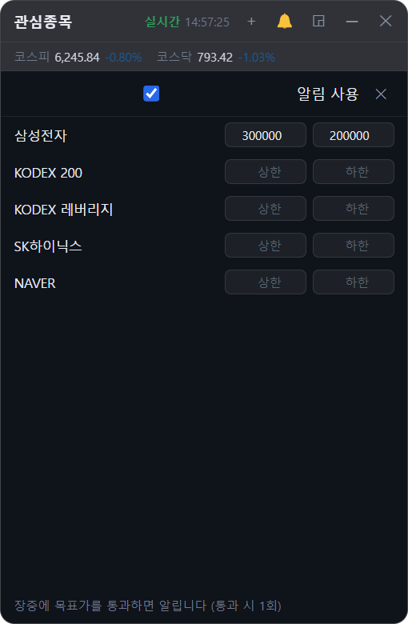

# 한국 주식 관심종목 위젯

바탕화면 위에 늘 떠 있는 작은 주식 창입니다. 관심 종목의 현재가와 차트를 한눈에 봅니다.
**증권사 계좌나 로그인 없이** 씁니다.


## 무엇을 할 수 있나요

- 관심 종목의 **현재가·등락률**을 봅니다 — 국내 주식·ETF와 미국 주식 (프리 · 애프터마켓 포함)
- 종목을 누르면 아래에 **차트**가 나옵니다 — 1일 · 1주 · 1개월 · 3개월 · 1년 · 3년
- 코스피 · 코스닥, 나스닥 · S&P 500, 나스닥 선물 · 원/달러를 위 지수 줄에, WTI · 미국채 10년 · VIX · SOX 까지 모두를 순위 패널의 `지표` 에 보여 줍니다
- **한글로 검색**해서 종목을 추가합니다 (`삼성전자`, `엔비디아`)
- 이동평균선 · 거래량 · 추세선 · 과열도 같은 보조 지표를 차트에 얹습니다
- 이동평균선 규칙을 지난 5년에 대 본 **추세 점검**을 보여 줍니다 (과거 통계이며 매매 권유가 아닙니다)
- 보유 수량과 평단가를 적어 두면 **평가손익**을 계산해 줍니다 — 종목을 고르고 상세 화면의 `＋ 보유 입력`에서 바로 넣습니다
- 정해 둔 가격을 지나가면 **알림**을 띄웁니다 (켜야만 동작)
- 창은 반투명하고 늘 다른 창 위에 있습니다. 마우스를 올리면 진해집니다

  

## 설치

[**⬇ 설치 파일 내려받기**](https://github.com/Wuid0801/stock-widget-v1/releases/latest/download/KRStockWidget-Setup.exe) — Windows 10/11 (64비트), 약 90MB

처음 실행하면 **"Windows의 PC 보호"** 창이 뜹니다. 코드 서명을 하지 않은 프로그램이라 나오는 경고입니다.
**추가 정보 → 실행**을 누르면 됩니다. 걱정되면 [소스에서 직접 빌드](#직접-빌드하기)해서 써도 됩니다.

## 사용법

### 위쪽 버튼

| 버튼 | 하는 일 |
|:---:|---|
| **＋** | 종목 검색·추가 |
| **⚙** | 설정 — 테마·투명도, 이동평균선, 목표가 알림, 보유 종목, 백업 |
| **◲** | 화면 오른쪽 아래로 작게 접기 (다시 누르면 원래대로) |
| **─** | 최소화 |
| **✕** | 종료 |

작업표시줄에 아이콘이 없는 위젯이라 **✕ 로 종료**합니다. 창이 안 보이면 `Ctrl+Alt+S` 로 불러옵니다.
이미 켜져 있을 때 다시 실행하면 새로 뜨지 않고, 켜져 있던 위젯이 앞으로 나옵니다.

### 종목 다루기

- **추가** — ＋ 를 누르고 종목명이나 6자리 코드를 입력합니다. 이름 중간 글자로도 찾습니다(`금융` → KB금융 · 하나금융지주, `바이오로직스` → 삼성바이오로직스). `Enter` 는 첫 결과 추가, `Esc` 는 닫기입니다.
- **삭제** — 목록 줄에 마우스를 올리면 오른쪽에 ✕ 가 나옵니다. 잘못 지웠으면 6초 안에 아래의 **되돌리기**를 누르세요. 목표가와 보유 정보도 함께 돌아옵니다.
- **실적 · 배당락 D-day** — 국내 종목은 실적 발표일, 미국 종목은 배당락일이 14일 안이면 이름 옆에 `실적 D-3` · `배당락 D-day` 처럼 작게 나옵니다(마우스를 올리면 일정 이름과 날짜). 일정은 6시간마다 다시 받습니다.
- **순서 바꾸기** — 줄을 끌어서 원하는 자리에 놓습니다.
- **창 옮기기·크기** — 위쪽 바를 끌면 옮겨지고, 가장자리를 끌면 크기가 바뀝니다. 세로로 늘리면 차트도 커집니다.
- **지수 줄 · 지수 차트** — 위쪽 지수 줄은 코스피·코스닥 → 나스닥·S&P 500 → 나스닥 선물·원/달러를 4초마다 넘깁니다(마우스를 올리면 멈춤). WTI · 미국채 10년 · VIX · SOX 는 순위 패널의 `지표` 에서 고릅니다. 나스닥 선물·WTI 는 거래소가 10분 늦게 주는 값이라 거래 중이면 헤더에 `10분지연` 이 붙고, 미국채 10년은 금리라 소수 셋째 자리와 bp(0.01%p) 등락(`4.970 +1.7bp`)으로 보입니다. 오른쪽 끝의 점(● ○ ○)이 지금 몇 번째 장인지 알려 주고, 누르면 그 장으로 바로 넘어갑니다. 누르면 아래 헤더와 차트가 그 지수로 바뀌고, 그 지수를 보는 동안은 그 장에 머뭅니다. 종목 줄을 누르면 돌아옵니다.

### 단축키

| 키 | 동작 |
|---|---|
| `↑` `↓` | 위·아래 종목으로 이동 |
| `1` ~ `7` | 차트 기간 — 1D · 1W · 1M · 3M · 1Y · 3Y · 전체 |
| `Ctrl+Z` | 방금 지운 종목 되돌리기 |
| `Esc` | 작게 접기 / 펴기 |
| `Ctrl+Alt+S` | 위젯 보이기 / 숨기기 (창이 숨어 있어도 동작) |

### 설정 (⚙)

- **화면** — 다크·라이트 테마, 투명도(마우스가 벗어났을 때의 진하기, 기본 74%)
- **이동평균선** — 5 · 10 · 20 · 40 · 60 · 80 · 120 · 240 · 360일 중 원하는 것만 켭니다 (기본 5 · 20 · 60). 켜 둔 선마다 아래 줄에서 **색과 굵기**(0.5~3px)를 바꿀 수 있습니다. 굵기는 슬라이더로 끌거나, 옆의 숫자를 눌러 직접 입력합니다(Enter 로 확정, Esc 로 취소). `↺` 는 그 선만 기본값으로 돌립니다. 고른 색은 다크·라이트 두 테마에 같이 씁니다.
- **목표가 알림** — 종목별로 위·아래 가격을 넣으면 장중에 그 가격을 지나가는 순간 Windows 알림이 한 번 뜹니다. 기본은 꺼져 있습니다.
- **보유 종목** — 들고 있는 종목의 수량·평단가를 고치거나 `✕`로 지웁니다. 새로 넣는 것은 상세 화면에서 합니다(아래 "보유").
- **백업** — `내보내기` 는 관심종목 · 보유(수량·평단가) · 목표가 · 화면 설정을 JSON 파일 하나로 저장합니다(기본 이름 `stock-widget-backup-날짜.json`, 문서 폴더). `불러오기` 로 그 파일을 고르면 무엇이 몇 개인지 확인 창으로 묻고, `바꾸기` 를 누르면 설정을 바꾼 뒤 다시 그립니다. 바꾸기 직전 설정은 고른 파일과 같은 폴더에 `stock-widget-before-import-날짜-시각.json` 으로 따로 저장해 두니, 잘못 불러왔으면 그 파일을 다시 불러오면 됩니다. PC 를 옮기거나 설정 파일이 깨졌을 때 씁니다. 창 위치 · 크기는 담지 않습니다.

### 보유

- **넣기** — 종목을 고르면 52주 막대 위에 `＋ 보유 입력`이 있습니다. 누르고 수량과 평단가를 넣은 뒤 Enter(또는 `저장`). Esc 는 취소입니다. `200,000`처럼 쉼표를 넣어도 됩니다. 둘 중 하나라도 비었거나 0 이하면 저장하지 않고 알려 줍니다.
- **고치기 · 지우기** — 보유 줄 끝의 `✎`를 누르면 같은 칸이 열리고 `삭제`도 나옵니다.
- **목록** — 들고 있는 종목은 이름 아래에 `10주 · 손익 +12.50%`가 붙습니다.
- **합계 줄** (지수 줄 아래) — `보유 3종목 · 손익 … · 오늘 …`. `오늘` 은 오늘 손익(보유 수량 × 전일 종가 대비 등락)입니다. 평가 금액은 툴팁에 있습니다(전일 종가를 못 받은 종목이 섞이면 오늘 대신 평가가 보입니다). 보유가 둘 이상이면 4초마다 합계 → 종목별 줄로 넘어가고, 마우스를 올리면 멈춥니다. 툴팁에 전체 목록과 환율이 나옵니다. 미국 주식은 환율로 원화 환산해 합계에 넣습니다.

모든 설정은 저장돼서 다시 켜도 그대로입니다.

## 화면 읽는 법

색은 한국 관례를 따릅니다 — **오르면 빨강, 내리면 파랑**.

### 위쪽 상태 표시

선택한 종목이 지금 어떤 상태인지 보여 줍니다.

| 표시 | 뜻 |
|---|---|
| 정규장 | 정규 시간(09:00~15:30, 미국 종목은 22:30~05:00)에 거래 중 |
| 프리마켓 / 애프터마켓 | 정규장 전 / 후 시간에 거래 중 (미국 종목은 17:00~22:30 / 05:00~09:00) |
| 장마감 | 오늘 거래가 끝남. 마지막 가격을 보여 줍니다 |
| 확인중 | 아직 상태를 알 수 없음. 미국 종목의 실시간 시세를 못 받아 야후 정규장 가격을 보여 줄 때도 이렇게 나옵니다 |
| 20분지연 | 실시간 시세를 못 받아 20분 늦은 값을 보여 주는 중 (국내 종목 · 지수) |
| 갱신 실패 | 시세를 아예 받지 못해 마지막으로 받은 값을 보여 주는 중. 옆의 시각은 그 값을 받은 때입니다 |

미국 종목 시각은 서머타임 기준이고, 서머타임이 끝나면(11월 첫 일요일) 한 시간씩 늦어집니다. 낮 시간의 미국 주식 주간거래는 볼 수 없습니다(무료 시세가 없음).

장중에는 30초마다, 장이 끝나면 5분마다 새로 받습니다. 상태 표시 왼쪽의 **↻** 를 누르면 기다리지 않고 바로 받습니다. 한 번 받은 뒤 5초 동안은 흐려지고 눌리지 않습니다.

### 종목 정보

- 종목명 옆의 회색 글씨는 **업종**입니다 (네이버 기준. 국내는 네이버 업종, 미국은 네이버 해외 업종이고, 네이버에 없으면 야후 영어 업종). ETF 는 비어 있습니다.
- 현재가 오른쪽의 작은 막대는 **오늘 하루의 캔들**입니다. 마우스를 올리면 시가·고가·저가·종가가 나옵니다.
- 가로로 긴 막대는 **52주 최저가~최고가** 사이에서 지금 가격이 어디쯤인지 보여 줍니다.
- 보유 줄 · 52주 막대 · 추세 점검 줄은 그 위의 `▾ 보유 · 52주 · 추세 점검`을 눌러 접고 펼 수 있습니다. 접어 둔 상태는 다시 켜도 그대로입니다. 접혀 있을 때 그 줄에 마우스를 올리면 세 줄의 내용이 툴팁으로 보입니다.

### 배지

| 예 | 뜻 |
|---|---|
| `안정 · RSI 56` | **과열도.** 최근 14거래일의 오르내림으로 본 과열 정도 (아래 표). 마우스를 올리면 일봉 RSI 와 주봉 RSI(14주, 이번 주는 진행 중)가 소수 한 자리로 나옵니다 |
| `3M -14.94%` | 지금 보고 있는 기간의 수익률 |
| `5/20 골든 · 6일 전` | 5일 이동평균선이 20일선을 **위로** 뚫은 날. 아래로 뚫으면 `데드` |
| `저항 돌파 +9.13% · 4일 전` | 저항선을 넘은 날과, 지금 그 선에서 떨어진 정도. 지지선 아래로 내려가면 `지지 이탈`. 넘은 뒤 4거래일(약 1주)까지만 뜹니다 |
| `수렴 12거래일 · 약 2주` | 지지선과 저항선이 만나기까지 남은 거래일 |

골든·데드와 돌파는 **하루가 끝나 확정된 뒤에만** 표시합니다. 장중에는 값이 계속 움직여 신호가 생겼다 사라지기 때문입니다. 그래서 오늘 생긴 신호는 다음 거래일에 `1일 전` 으로 처음 나옵니다.

| RSI | 과열도 |
|---|---|
| 80 이상 | 극과열 |
| 70 ~ 80 | 과열 |
| 45 ~ 70 | 안정 |
| 30 ~ 45 | 주의 |
| 30 미만 | 과매도 |

### 추세 점검

52주 막대 아래의 한 줄은 **이동평균선 규칙을 지난 5년 일봉에 대 본 결과**입니다. 기간 버튼과 상관없이 같은 값이 나옵니다.

`정배열·20선↑ · 20선>60선 34일째 · 5년: 구분 안 됨`

| 조각 | 뜻 |
|---|---|
| `정배열·20선↑` | 지금 이동평균선의 배열(정배열 5>20>60>120 · 역배열 · 혼조)과 20일선이 오르는지 |
| `20선>60선 34일째` | 20일선이 60일선 위에 올라선 지 34일. 아래면 `20선<60선`. 툴팁의 "20/60 규칙"(위면 보유, 아래면 정리)으로는 지금 보유 쪽입니다 |
| `5년: 구분 안 됨` | 그 규칙이 지난 5년 동안 **시점만 엉뚱하게 바꾼 가짜 규칙 200개**보다 나았는지. 데이터가 짧은 종목은 실제로 본 기간(`2년:` · `3년:`)으로 나옵니다 |

판정은 `나음`(빨강) · `못함`(파랑) · `구분 안 됨` · `표본 부족` 입니다. 한 종목 5년치로는 대부분 **구분 안 됨**이 나오는 게 정상입니다 — "효과 없음"이 아니라 "이 표본으로는 알 수 없다"는 뜻입니다.

`나음` · `못함`도 우연일 수 있습니다. 규칙이 아무 쓸모없어도 판정마다 20번에 1번꼴로 나오므로, 관심종목이 20개쯤이면 한두 종목에 색이 붙어도 이상하지 않습니다. 또 이 줄은 **지난 기간의 설명**입니다 — 10년치로 확인해 보니 앞 5년의 결과로 뒤 5년을 맞히지 못했습니다.

마우스를 올리면 자세한 숫자가 나옵니다. 규칙과 그냥 보유의 누적 · 연 수익 · 최대 낙폭, 그리고 지금과 같은 배열이었던 날들의 20거래일 뒤 수익을 평소와 견준 값입니다.

- 그날 종가로 판단하고 **다음 날 종가에 사고판다**고 계산합니다. 오늘 봉은 넣지 않습니다.
- 비용은 국내 종목 왕복 0.25%, 해외 종목 · 지수 0.10% 를 뺍니다. 배당 · 세금 · 환전은 빠져 있습니다.
- 상장한 지 2년이 안 된 종목은 이 줄이 나오지 않습니다.
- 관심종목은 이미 고른(대개 오른) 종목이라 결과가 좋게 나오기 쉽습니다. **과거 통계이며 매매 권유가 아닙니다.**

### 차트

- **1D · 1W 시간외** — 프리마켓 → 정규장 → 애프터마켓을 한 줄로 이어 그리고, 정규장 밖 구간은 배경이 옅은 회색입니다. 국내는 08:00~08:50 · 15:40~20:00(NXT), 미국은 17:00~22:30 · 05:00~09:00 입니다. 1D 는 프리마켓이 열리면 새 하루로 넘어가 전날 차트는 사라집니다. 1W 는 닷새 모두 시간외까지 30분봉으로 그립니다. ETF 와 지수는 시간외가 없어 정규장만 나옵니다.
- **정규장 / 전체** (1D · 1W) — 차트 왼쪽 위의 `전체` 를 누르면 `정규장` 으로 바뀌어 장전 · 장후를 빼고 정규장(국내 09:00~15:30)만 그립니다. 다시 누르면 돌아오고, 고른 것은 저장됩니다. 1M 이상(일봉)은 늘 정규장이고 종가는 15:30 공식 종가입니다.
- **전체** 탭 — 야후에 있는 처음부터 지금까지입니다(국내 종목은 2000년, 코스피는 1996년부터). 봉 크기는 기간에 따라 야후가 정합니다 — 오래된 종목은 월봉, 최근 상장주는 주봉, 오래된 미국 주식은 분기봉입니다. 그래서 이동평균선 · 골든/데드 · 지지선·저항선 · 확대는 없고 선 그래프로만 그립니다.
- **캔들** (1M · 3M, 1Y · 3Y 는 70봉(약 석 달) 이하로 확대했을 때) — 몸통은 시가(그날 첫 가격)~종가(마지막 가격), 세로선은 그날의 최저~최고가입니다. 시가보다 오르면 빨강, 내리면 파랑입니다. 차트 왼쪽 위의 작은 아이콘을 누르면 선 그래프와 바꿀 수 있습니다.
- **확대** (3M · 1Y · 3Y) — 차트를 누른 채 좌우로 끌면 그 구간만 크게 보입니다. 차트를 더블클릭하거나 왼쪽 위 `전체` 를 누르면 돌아옵니다.
- **이동평균선** (1M · 3M · 1Y · 3Y) — 최근 N일의 평균 가격입니다. 보고 있는 기간에 비해 너무 긴 선은 저절로 빠집니다.
- **거래량** — 차트 아래쪽 막대입니다.
- **툴팁** — 차트에 마우스를 올리면 그 봉의 가격 옆에 등락률이 붙습니다(`213,000 -8.19%`, 오르면 빨강 · 내리면 파랑). 기준은 1D 는 전일 종가(마지막 봉은 위의 등락률과 같습니다), 1W 는 그날의 전일 종가, 1M 이상은 바로 앞 봉 종가(일봉이면 그날 등락률)입니다.
- **지지선·저항선** (3M · 1Y) — 저점끼리, 고점끼리 이은 점선입니다. 어느 선이 지지인지는 차트 위 범례에 색과 값으로 나옵니다. 믿을 만한 선이 없으면 그리지 않습니다. 확대하면 숨습니다.
- **가로 점선** — `평단` 내 평단가, `전일` 어제 종가, `애프터`·`프리` 정규장 밖 현재가 (뒤의 셋은 1D 에서만). 선끼리 가까우면 이름표가 `전일·전고` 처럼 하나로 합쳐지고, 차트 범위 밖이면 위·아래 끝에 `▲ 전고 241,500` 처럼 이름과 값이 나옵니다. 차트에 마우스를 올리면 각 선의 값이 오른쪽 끝(가격 눈금 옆)에 나옵니다.
- **보조 지표** (설정 → 보조 지표, 기본은 모두 꺼짐) — 켜 둔 것만 그립니다.
  - **볼린저** (1M · 3M · 1Y · 3Y) — 20일 평균 ± 2표준편차의 위·아래 점선과 그 사이 옅은 띠입니다. 가운데 선은 `20` 이동평균으로 켭니다.
  - **VWAP** (1D) — 그날 정규장의 거래량 가중 평균가입니다. 시간외 구간에는 그리지 않습니다.
  - **거래량 평균** (모든 기간) — 거래량 막대 위의 20봉 평균선입니다. 평균의 2배를 넘는 막대는 진하게 칠하고, 툴팁에 `평균의 3.1배` 처럼 나옵니다.
  - **전일 고저** (1D) — `전고`(옅은 빨강) · `전저`(옅은 파랑) 어제 고가·저가 점선입니다.
  - **매물대** (1M · 3M · 1Y · 3Y) — 보고 있는 구간에서 가격대별로 거래가 얼마나 쌓였는지를 차트 오른쪽의 옅은 가로 막대로 보입니다. 가장 많이 거래된 가격대는 진하게 칠하고 범례에 가격대가 나옵니다. 확대하면 그 구간의 매물대입니다.
  - **지수 대비** (1M 이상) — 기간 배지에 `초과 +3.10%p` 처럼 종목 수익률에서 같은 기간 지수 수익률을 뺀 값이 붙습니다. 코스피 종목은 코스피, 코스닥 종목은 코스닥, 미국 종목은 S&P 500 과 비교하고, 배지에 마우스를 올리면 지수 수익률이 나옵니다. 차트에는 그 지수를 첫 봉의 종목 가격에서 시작하게 맞춘 회색 점선이 겹쳐져, 언제 벌어졌는지 보입니다(범례에 지수 이름과 값).
  - **SAR** (1D · 1W · 1M · 3M · 1Y · 3Y) — 파라볼릭 SAR 입니다. 상승 추세면 봉 아래에 옅은 빨강 점, 하락 추세면 봉 위에 옅은 파랑 점이 찍히고, 가격이 점을 뚫으면 방향이 바뀝니다. 차트 위 범례에 `하락 4일째`(1D · 1W 는 `하락 · 13:20부터`)처럼 지금 방향과 이어진 기간이 나오고, 마우스를 올리면 그 봉의 SAR 값이 나옵니다. 매수 · 매도 신호가 아니라 추세의 상태입니다 — 횡보장에서는 자주 뒤집힙니다(SOXL 1Y 일봉에서 27번 중 8번이 5일 안에 되돌아감). 1D 는 정규장 봉만으로 그날 첫 봉부터, 1W 는 5일 전 첫 봉부터 계산합니다.
  - **RSI** (1D · 1W · 1M · 3M · 1Y · 3Y) — RSI(14)와 시그널(RSI 의 9봉 평균)을 가격 차트 아래 따로 둔 칸(약 45px)에 그립니다(시그널은 점선, 30 · 70 은 아주 옅은 점선). 켜 두면 차트가 그 칸만큼 커져 가격 차트 크기는 그대로이고, 그만큼 관심종목 목록이 덜 보입니다. 차트 왼쪽 위 `RSI` 버튼으로 바로 켜고 끕니다(설정의 RSI 칩과 같은 값, 켜져 있으면 또렷함). RSI 가 시그널을 위로 뚫은 봉에는 빨강 점, 아래로 뚫은 봉에는 파랑 점이 찍힙니다. 골든 · 데드처럼 봉이 끝나 확정된 교차만 속이 찬 점으로 찍습니다 — 1D 는 그 5분봉이 끝나면, 일봉은 다음 거래일에. 1D 는 지금 진행 중인 5분봉에서 뚫은 것도 테두리만 있는 점으로 미리 보이고, 봉이 끝날 때까지 유지되면 속이 찬 점이 되며, 그 전에 되돌아가면 사라집니다(범례는 확정된 교차만 따릅니다). 차트 위 범례에 `상향 3일째`(1D · 1W 는 `상향 · 13:20부터`)처럼 마지막 교차 뒤 RSI 가 시그널 위(상향) · 아래(하향)에 있는 기간이 나오고, 차트에 마우스를 올리면 툴팁에 그 봉의 `RSI 56.2 · 시그널 52.1` 이 나옵니다. 1D 는 앞 거래일 5분봉을 이어 계산해 장 시작부터 값이 있고(증권사 앱처럼 날을 넘어 이어짐), 1W 는 받은 5일치 30분봉만으로 계산해 앞쪽 하루 반쯤은 비어 있습니다. 매수 · 매도 신호가 아니라 상태 표시입니다.
- **차트만 보기** — 차트 왼쪽 위, 캔들/선 아이콘 옆의 겹친 판 모양 버튼을 누르면 이동평균선 · 보조 지표 · 지지선·저항선 · 골든/데드 표시 · 가로 점선 · 기간 배지를 한 번에 숨기고 가격과 거래량 막대만 남깁니다. 칩 설정은 그대로라 다시 누르면 돌아오고, 켜 둔 상태는 저장됩니다.
- **시장 지표** — 순위 패널 위의 `지표` 를 누르면 시장 항목이 국내 · 미국 · 위험 · 자금으로 묶여 값 · 오늘 등락 · 5일 변화와 함께 나옵니다(금리는 bp). 줄을 누르면 아래 헤더와 차트가 그 항목으로 바뀝니다 — 코스피200 현물 · 선물(20분 지연)도 눌러 오늘 장중 흐름(1D · 1W)과 일봉을 볼 수 있습니다(야후에 없어 네이버로 그립니다). 베이시스(선물 − 현물 — 플러스면 오를 쪽, 마이너스면 내릴 쪽에 돈이 몰린 것으로 봅니다. 선물이 20분 늦어 같은 시각의 현물과 빼고, 메모에 그 시각(`13:16 기준`)이 붙습니다. 마우스를 올리면 뜻 · 만기 효과가 나옵니다), 외국인 현물 · 선물 수급(마지막 확정일 순매수와 `2일 연속 순매수` 같은 연속 일수, 18:00 전 오늘 값은 `오늘 잠정`), 미국 HY OAS(하이일드 회사채 가산금리, 1~2영업일 늦음)도 여기서 봅니다 — 베이시스 · 수급 · HY OAS 줄은 차트가 없어 누를 수 없습니다. 맨 위 **데드캣 점검** 줄은 외국인 현물 · 선물 수급, SOX, 원/달러, VIX, HY OAS, 미국채 10년 일곱 가지를 숫자 기준으로 긍정 · 중립 · 위험으로 판정해 개수만 보여 주고(예: `긍정 3 · 중립 1 · 위험 2` — 마우스를 올리면 판정마다 어느 지표인지 나옵니다), 해당 줄 앞의 점(초록 · 회색 · 주황)에 마우스를 올리면 근거가 나옵니다. 반등을 볼 때 흔히 쓰는 경험칙을 옮긴 참고용이라 매수 · 매도 판단을 대신하지 않습니다. 코스피 · 코스닥 · 나스닥 · S&P 500 줄의 이름 아래에는 코스톨라니 달걀 국면과 방향(`달걀 A2→B1 · 다음 B2` — 직전 국면→지금 국면 · 달걀 순서의 다음 국면, 해석 — 아래 지표 보기의 기법 점검과 같은 기준)이 붙고, 마우스를 올리면 근거 · 바뀐 지 며칠째인지 · 여섯 국면이 나옵니다. 거래량이 없는 SOX · 환율 · VIX · 금리와 선물 · WTI 에는 없습니다. 줄 끝의 작은 선은 최근 20개 값의 흐름입니다.
- **시장 순위** — 헤더의 막대 모양 버튼(＋ 와 ⚙ 사이)을 누르면 순위 패널이 열립니다. `국내` 는 인기 검색 · 급등 · 급락 · 거래대금 · 업종 · 테마, `미국` 은 급등 · 급락 · 거래대금 · 시총 상위(미국 인기 검색은 데이터가 없습니다)를 20위까지 보여 줍니다. 종목을 누르면 관심종목에 넣고 엽니다(이미 있으면 ✓ 표시, 누르면 그 종목으로). 급등 · 급락 · 거래대금은 잡음을 거릅니다 — 국내는 일반 주식만(ETF · ETN · 우선주 제외) · 거래대금 10억 원 이상, 미국은 일반 주식만 · 시총 3억 달러 이상. 목록 맨 위에 기준 시각과 거른 기준이 나오고, 장이 닫혀 있으면 지난 장 순위입니다. `업종` · `테마` 는 오늘 어느 분류가 강한지를 등락률 순으로 보여 주고 `↑126 ↓40` 처럼 오른 · 내린 종목 수를 붙입니다 — 등락률은 묶음 평균이라 큰 종목 한두 개에 끌리니 수를 같이 보세요. 5종목 미만 묶음은 뺍니다. 업종 · 테마를 누르면 그 안의 종목이 등락률 순으로 나오고(급등과 같이 거름), 맨 위 `←` 줄을 누르면 목록으로 돌아옵니다.
- **지표 보기** — 종목명 · 업종 오른쪽의 작은 `지표` 버튼을 누르면 차트 자리가 지표 화면으로 바뀝니다. 그동안 버튼은 `차트` 가 되어 누르면 돌아갑니다. 지수 · 환율에는 없습니다.
  - **오늘** — 거래량과 20일 평균 대비 배수(`1,182만 주 · 20일 평균의 0.55배`), 국내 주식은 NXT 포함 거래량, 거래대금 · 시가총액 · 외국인 소진율. 장중에는 그때까지의 거래량이라 배수가 작게 나옵니다.
  - **기간 수익률** — 1주 · 1개월 · 3개월 · 올해 · 1년.
  - **기법 점검** (참고용) — 흔히 쓰는 투자 기법으로 본 지금 상태입니다. 계산할 수 없는 줄은 빠지고, 줄에 마우스를 올리면 규칙이 나옵니다. 매수 · 매도 판단을 대신하지 않습니다.
    - **추세 추종** — 종가가 200일선 위면 보유, 아래면 현금 구간으로 보고 그 상태가 며칠째인지(`200일선 236,881 아래 · 현금 구간 4일째`).
    - **모멘텀** — 최근 1개월을 뺀 12개월 수익률(1개월 전 종가 / 12개월 전 종가, 날짜로 셉니다)과 관심종목 안 순위(`12-1개월 +34.20% · 관심종목 3/9위`).
    - **적립식** — 최근 12달 매달 첫 거래일에 같은 금액을 샀다면의 평균 단가와 지금 가격 대비.
    - **비중** (보유 종목이 둘 이상일 때) — 보유 종목 평가금액 중 이 종목의 몫과 균등 비중. 미국 주식은 합계 줄과 같은 환율로 원화 환산합니다.
    - **반등 점검** — 최근 60거래일 고점에서 15% 넘게 빠진 뒤 반등 중일 때만, 고점 → 저점 · 되돌린 비율 · 20일선 위아래 · RSI · 반등 거래량(하락 때 대비). 진짜 반등인지(데드캣) 볼 때 쓰는 조건이고 결론은 내리지 않습니다.
    - **코스톨라니** — 코스톨라니 달걀에서 지금 어느 자리인지입니다. 상승장 · 하락장은 저마다 세 국면을 차례로 지나므로(A1 바닥 뒤 상승 초기 → A2 상승 · 거래량 증가 → A3 과열 → B1 꼭대기 뒤 하락 초기 → B2 하락 · 거래량 증가 → B3 투매 → 다시 A1) 순서를 기억해 한 칸씩 나아갑니다 — 거래량이 늘면(20일 평균 / 60일 평균 1배 이상) A1 → A2 · B1 → B2, RSI 70 이상(또는 거래량 1.5배 이상)이면 과열 A3, RSI 30 이하(또는 1.5배 이상)이면 투매 B3, 20일선이 60일선 아래로 내려가면 A3 → B1, 다시 올라서면 B3 → A1. 과열 · 투매는 칸을 건너뛰어 바로 가고, 과열 없이 20거래일 넘게 내리면 B1, 투매 없이 그만큼 오르면 A1 로 넘어갑니다. 되돌아가지 않아 하락장 중의 반등이 A1 이 되지 않습니다. `B2 → B3 · 11일째 · 투매 · 다음 A1` 은 11거래일 전에 B2 에서 B3 로 바뀌었고 다음은 A1(20일선이 다시 60일선 위로 올라서면)이라는 뜻입니다. 원래 이론에는 숫자 기준이 없어 해석입니다.
  - **투자자별 순매수** (국내) — 외국인 · 기관 · 개인의 5일 · 20일 합과 최근 10일(주).
  - **주주 구성** (국내 주식) — 최대주주 · 5% 이상 주주 · 자사주 지분율과 외국인 지분율 · 유동주식 비율(네이버 금융 기업정보). 공시된 주주만 있어 기관 · 개인 지분율은 없습니다. 우선주는 회사(보통주) 기준 값입니다.
  - **실적** — 실적 발표 일정과 D-day(국내), 최근 4분기 매출액 · 영업이익 · 당기순이익(`E` 는 증권사 추정치). 미국은 영업이익 자리에 EBIT 입니다.
  - **가치 지표** — PER · 추정 PER · PBR · EPS · BPS · 배당, 증권사 컨센서스(목표가 평균과 현재가 대비, 투자의견 평균, 미국은 최저 ~ 최고 목표가). 컨센서스는 증권사 추정치라 참고용입니다.
  - **ETF** — NAV · 괴리율 · 분배율 · 기초지수 · 운용사.
  - **동종 업종** — 같은 업종 종목들의 오늘 등락률.

차트에 마우스를 올리면 그 날의 가격·거래량이 나오고, 이동평균선 값은 차트 위 범례에 나옵니다. 다른 종목이나 기간을 누르면 새 차트가 올 때까지 `불러오는 중…` 이 나옵니다(네트워크가 느리면 몇 초).

## 알아 둘 점

- **시세는 무료 공개 데이터입니다.** 국내 · 미국 현재가는 네이버(실시간, 못 받으면 야후), 차트는 야후 파이낸스에서 받습니다(국내 1D · 1W 는 네이버 실시간 분봉 — 못 받으면 야후). 야후의 국내 일봉은 20분 늦어서, 오늘 봉만 현재가로 맞춰 둡니다. 야후 국내 일봉에 하루가 통째로 빠진 날이 있으면 그날만 네이버 일봉으로 채웁니다. 지표 보기의 매매동향 · 주주 구성 · 실적 · 가치 지표 · 컨센서스와 시장 순위도 네이버에서 받습니다.
- 두 곳 모두 공식 문서가 없는 API라 예고 없이 바뀔 수 있습니다. 매매용 시세가 필요하면 증권사 공식 앱을 쓰세요.
- 네이버에는 있지만 야후에 없는 일부 종목(ETN 등)은 추가할 수 없습니다. 추가할 때 이유를 알려 줍니다.
- 화면 배율이 100%가 아니면 창 크기가 1~2px 어긋날 수 있습니다.
- 설정 파일은 `%APPDATA%\kr-stock-widget\config.json` 입니다. 앱을 끈 뒤 이 파일을 지우면 처음 상태로 돌아갑니다. 손으로 고치다 파일이 깨지면 위젯은 그 파일을 `config.broken-<숫자>.json` 으로 옮겨 두고 처음 상태로 뜹니다(알림으로 알려 줍니다). 평단가 · 목표가는 이 파일에만 있으니 ⚙ 의 백업으로 내보내 두면 좋습니다 — 옮겨 둔 `config.broken-…json` 이나 `config.json` 을 그대로 불러와도 읽을 수 있는 설정만 골라 되살립니다.
- Windows 11 에서 만들고 확인했습니다.

## 직접 빌드하기

[Node.js](https://nodejs.org/) 22.12 이상이 필요합니다(Electron 44 가 요구합니다). Electron 실행 파일은 처음 `npm start` 할 때 내려받습니다.

```bash
npm install
npm start       # 실행
npm run dist    # 설치 파일 만들기 → dist/KRStockWidget-Setup.exe
npm test        # 테스트
npm run check:sources  # 시세 출처(네이버 · 야후 등)가 지금도 쓸 수 있는지 점검 — 매주 GitHub Actions 에서도 돈다
```

코드 구조, 동작 원리, 설계 이유와 실측 기록은 [개발 문서](docs/DEVELOPMENT.md)에 있습니다.
