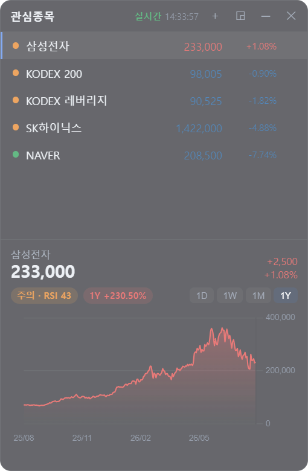

# 한국 주식 관심종목 위젯

바탕화면 위에 늘 떠 있는 작은 주식 창입니다. 관심 종목의 현재가와 차트를 한눈에 봅니다.
**증권사 계좌나 로그인 없이** 씁니다.



## 무엇을 할 수 있나요

- 관심 종목의 **현재가·등락률**을 봅니다 — 국내 주식·ETF와 미국 주식
- 종목을 누르면 아래에 **차트**가 나옵니다 — 1일 · 1주 · 1개월 · 3개월 · 1년
- 코스피 · 코스닥 지수를 위에 함께 보여 줍니다
- **한글로 검색**해서 종목을 추가합니다 (`삼성전자`, `엔비디아`)
- 이동평균선 · 거래량 · 추세선 · 과열도 같은 보조 지표를 차트에 얹습니다
- 보유 수량과 평단가를 적어 두면 **평가손익**을 계산해 줍니다
- 정해 둔 가격을 지나가면 **알림**을 띄웁니다 (켜야만 동작)
- 창은 반투명하고 늘 다른 창 위에 있습니다. 마우스를 올리면 진해집니다

  

## 설치

[**⬇ 설치 파일 내려받기**](https://github.com/Wuid0801/stock-widget-v1/releases/latest/download/KRStockWidget-Setup.exe) — Windows 10/11 (64비트), 약 90MB

처음 실행하면 **"Windows의 PC 보호"** 창이 뜹니다. 코드 서명을 하지 않은 프로그램이라 나오는 경고입니다.
**추가 정보 → 실행**을 누르면 됩니다. 걱정되면 [소스에서 직접 빌드](#직접-빌드하기)해서 써도 됩니다.

## 사용법

### 위쪽 버튼

| 버튼 | 하는 일 |
|:---:|---|
| **＋** | 종목 검색·추가 |
| **⚙** | 설정 — 테마·투명도, 이동평균선, 목표가 알림, 보유 종목 |
| **◲** | 화면 오른쪽 아래로 작게 접기 (다시 누르면 원래대로) |
| **─** | 최소화 |
| **✕** | 종료 |

작업표시줄에 아이콘이 없는 위젯이라 **✕ 로 종료**합니다. 창이 안 보이면 `Ctrl+Alt+S` 로 불러옵니다.

### 종목 다루기

- **추가** — ＋ 를 누르고 종목명이나 6자리 코드를 입력합니다. `Enter` 는 첫 결과 추가, `Esc` 는 닫기입니다.
- **삭제** — 목록 줄에 마우스를 올리면 오른쪽에 ✕ 가 나옵니다. 잘못 지웠으면 6초 안에 아래의 **되돌리기**를 누르세요. 목표가와 보유 정보도 함께 돌아옵니다.
- **순서 바꾸기** — 줄을 끌어서 원하는 자리에 놓습니다.
- **창 옮기기·크기** — 위쪽 바를 끌면 옮겨지고, 가장자리를 끌면 크기가 바뀝니다. 세로로 늘리면 차트도 커집니다.

### 단축키

| 키 | 동작 |
|---|---|
| `↑` `↓` | 위·아래 종목으로 이동 |
| `1` ~ `5` | 차트 기간 — 1D · 1W · 1M · 3M · 1Y |
| `Ctrl+Z` | 방금 지운 종목 되돌리기 |
| `Esc` | 작게 접기 / 펴기 |
| `Ctrl+Alt+S` | 위젯 보이기 / 숨기기 (창이 숨어 있어도 동작) |

### 설정 (⚙)

- **화면** — 다크·라이트 테마, 투명도(마우스가 벗어났을 때의 진하기, 기본 74%)
- **이동평균선** — 5 · 10 · 20 · 40 · 60 · 80 · 120 · 240 · 360일 중 원하는 것만 켭니다 (기본 5 · 20 · 60)
- **목표가 알림** — 종목별로 위·아래 가격을 넣으면 장중에 그 가격을 지나가는 순간 Windows 알림이 한 번 뜹니다. 기본은 꺼져 있습니다.
- **보유 종목** — 수량과 평단가를 넣으면 평가금액과 손익이 나오고, 지수 줄 아래에 전체 합계가 뜹니다. 미국 주식은 환율로 원화 환산합니다.

모든 설정은 저장돼서 다시 켜도 그대로입니다.

## 화면 읽는 법

색은 한국 관례를 따릅니다 — **오르면 빨강, 내리면 파랑**.

### 위쪽 상태 표시

선택한 종목이 지금 어떤 상태인지 보여 줍니다.

| 표시 | 뜻 |
|---|---|
| 정규장 | 정규 시간(09:00~15:30)에 거래 중 |
| 프리마켓 / 애프터마켓 | 정규장 전 / 후 시간에 거래 중 |
| 장마감 | 오늘 거래가 끝남. 마지막 가격을 보여 줍니다 |
| 확인중 | 아직 상태를 알 수 없음 |
| 20분지연 | 실시간 시세를 못 받아 20분 늦은 값을 보여 주는 중 |

장중에는 30초마다, 장이 끝나면 5분마다 새로 받습니다.

### 종목 정보

- 종목명 옆의 회색 글씨는 **업종**입니다 (야후 기준이라 영어).
- 현재가 오른쪽의 작은 막대는 **오늘 하루의 캔들**입니다. 마우스를 올리면 시가·고가·저가·종가가 나옵니다.
- 가로로 긴 막대는 **52주 최저가~최고가** 사이에서 지금 가격이 어디쯤인지 보여 줍니다.

### 배지

| 예 | 뜻 |
|---|---|
| `안정 · RSI 56` | **과열도.** 최근 14거래일의 오르내림으로 본 과열 정도 (아래 표) |
| `3M -14.94%` | 지금 보고 있는 기간의 수익률 |
| `5/20 골든 · 6일 전` | 5일 이동평균선이 20일선을 **위로** 뚫은 날. 아래로 뚫으면 `데드` |
| `저항 돌파 +9.13% · 7일 전` | 저항선을 넘은 날과, 지금 그 선에서 떨어진 정도. 지지선 아래로 내려가면 `지지 이탈` |
| `수렴 12거래일 · 약 3주` | 지지선과 저항선이 만나기까지 남은 거래일 |

골든·데드와 돌파는 **하루가 끝나 확정된 뒤에만** 표시합니다. 장중에는 값이 계속 움직여 신호가 생겼다 사라지기 때문입니다. 그래서 오늘 생긴 신호는 다음 거래일에 `1일 전` 으로 처음 나옵니다.

| RSI | 과열도 |
|---|---|
| 80 이상 | 극과열 |
| 70 ~ 80 | 과열 |
| 45 ~ 70 | 안정 |
| 30 ~ 45 | 주의 |
| 30 미만 | 과매도 |

### 차트

- **캔들** (1M · 3M) — 몸통은 시가(그날 첫 가격)~종가(마지막 가격), 세로선은 그날의 최저~최고가입니다. 시가보다 오르면 빨강, 내리면 파랑입니다. 차트 왼쪽 위의 작은 아이콘을 누르면 선 그래프와 바꿀 수 있습니다.
- **이동평균선** (1M · 3M · 1Y) — 최근 N일의 평균 가격입니다. 보고 있는 기간에 비해 너무 긴 선은 저절로 빠집니다.
- **거래량** — 차트 아래쪽 막대입니다.
- **지지선·저항선** (3M · 1Y) — 저점끼리, 고점끼리 이은 점선입니다. 믿을 만한 선이 없으면 그리지 않습니다.
- **가로 점선** — `평단` 내 평단가, `전일` 어제 종가, `애프터`·`프리` 정규장 밖 현재가 (뒤의 셋은 1D 에서만)

차트에 마우스를 올리면 그 날의 가격·거래량이 나오고, 이동평균선 값은 차트 위 범례에 나옵니다.

## 알아 둘 점

- **시세는 무료 공개 데이터입니다.** 국내 현재가는 네이버(실시간), 차트와 미국 주식은 야후 파이낸스에서 받습니다. 야후의 국내 차트는 20분 늦어서, 오늘 봉만 현재가로 맞춰 둡니다.
- 두 곳 모두 공식 문서가 없는 API라 예고 없이 바뀔 수 있습니다. 매매용 시세가 필요하면 증권사 공식 앱을 쓰세요.
- 네이버에는 있지만 야후에 없는 일부 종목(ETN 등)은 추가할 수 없습니다. 추가할 때 이유를 알려 줍니다.
- 화면 배율이 100%가 아니면 창 크기가 1~2px 어긋날 수 있습니다.
- 설정 파일은 `%APPDATA%\kr-stock-widget\config.json` 입니다. 앱을 끈 뒤 내용을 `{}` 로 바꾸면 처음 상태로 돌아갑니다.
- Windows 11 에서 만들고 확인했습니다.

## 직접 빌드하기

[Node.js](https://nodejs.org/) 18 이상이 필요합니다.

```bash
npm install
npm start       # 실행
npm run dist    # 설치 파일 만들기 → dist/KRStockWidget-Setup.exe
npm test        # 테스트
```

코드 구조, 동작 원리, 설계 이유와 실측 기록은 [개발 문서](docs/DEVELOPMENT.md)에 있습니다.
