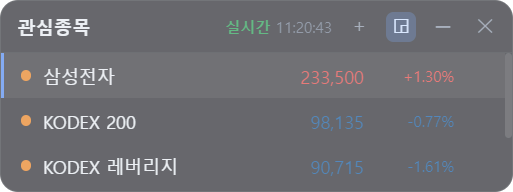

# 한국 주식 관심종목 데스크톱 위젯

화면 위에 항상 떠 있는 프레임리스 반투명 주식 위젯. Electron으로 만들었고 **증권사 계좌 없이** 동작합니다.


## 기능

- 항상 위에 표시되는 프레임리스 반투명 창 (마우스를 올리면 진해짐)
- 관심종목 리스트 → 클릭하면 아래에 차트 표시
- 코스피 · 코스닥 지수를 상단에 함께 표시
- 현재가 · 등락(원/%) · RSI(14) 기반 과열도 5단계
- 타임프레임 전환 (1D / 1W / 1M / 1Y) 및 해당 구간 수익률 표시
- 일봉 차트에 5일 · 20일 이동평균선
- 52주 최저~최고 구간에서 현재가 위치
- **목표가 알림** (선택 기능 — 켜야만 동작)
- **한글 종목 검색**으로 관심종목 추가/삭제 (주식·ETF 모두)
- 드래그로 관심종목 순서 변경
- 장중 30초 자동 갱신 (장 마감 후에는 5분으로 자동 완화)
- 우하단으로 접기 / 최소화 / 전역 단축키로 표시·숨김
- 창 위치·크기, 선택 종목, 타임프레임, 관심종목을 저장해 재실행 시 복원

  

## 설치 및 실행

Node.js 18 이상이 필요합니다 (메인 프로세스에서 전역 `fetch`를 씁니다).

```bash
npm install
npm start
```

첫 실행은 화면 중앙에 340×520으로 뜹니다.

## 사용법

| 버튼 | 기능 |
|:---:|---|
| **＋** | 종목 검색·추가 (한글명 또는 6자리 코드) |
| **🔔** | 목표가 알림 설정 |
| **◲** | 우하단으로 접기 (관심종목 3개만) / 다시 누르면 원래대로 |
| **─** | 최소화 |
| **✕** | 종료 |

- **창 이동** — 상단 바 드래그 · **크기 조절** — 창 가장자리 드래그
- **종목 삭제** — 목록 행에 마우스를 올리면 오른쪽에 ✕
- **순서 변경** — 목록 행을 드래그해서 원하는 자리에 놓기
- **검색** — `Enter`로 첫 결과 추가, `Esc`로 닫기. 접힌 상태에서 열면 잠시 펼쳐졌다가 닫을 때 다시 접힙니다.

### 목표가 알림

🔔 버튼에서 설정합니다. **기본은 꺼져 있고, "알림 사용"을 켜야만 동작합니다.**

- 종목별로 상한 / 하한을 넣어두면 **장중에 그 가격을 통과할 때** Windows 알림이 뜹니다.
- 통과하는 순간에만 한 번 알립니다. 목표가를 넘어선 상태로 머무는 동안에는 다시 울리지 않고, 되돌아왔다가 다시 통과하면 그때 또 알립니다.
- 앱을 켤 때 이미 목표가를 넘겨 있어도 울리지 않습니다 (첫 갱신은 기준만 잡습니다).
- 장 마감 중에는 울리지 않습니다.
- 관심종목을 삭제하면 그 종목의 목표가도 함께 지워집니다.

### 전역 단축키

| 단축키 | 동작 |
|---|---|
| `Ctrl` + `Alt` + `S` | 위젯 표시 / 숨김 |

다른 프로그램이 이미 쓰는 조합이면 등록에 실패하고 콘솔에 경고만 남습니다. 바꾸려면 `main.js`의 `TOGGLE_KEY`를 수정하세요.

> 작업표시줄에 아이콘이 없는 위젯이라(`skipTaskbar`) **✕ 버튼으로 종료**해야 합니다.
> 최소화하면 그동안만 작업표시줄에 나타나고, 되살리면 다시 숨겨집니다.
> 창을 놓쳤을 때는 위 단축키로 되살릴 수 있습니다.

## 데이터 소스

계좌가 필요 없는 무료 소스만 씁니다. 용도에 따라 두 곳을 나눠 쓰고 있습니다.

| 용도 | 소스 | 비고 |
|---|---|---|
| 현재가 · 등락 | Naver 실시간 | 지연 0초, 다종목 1회 요청 |
| 코스피 · 코스닥 지수 | Naver 실시간 | 두 지수 1회 요청 |
| 차트 시계열 · RSI · 이동평균 | Yahoo Finance | **한국 시세는 20분 지연** |
| 52주 최고/최저 | Yahoo Finance | `meta` 에 포함되어 추가 요청 없음 |
| 종목 검색 | Naver 자동완성 | 주식·ETF 한글 검색 |

### 왜 나눠 쓰는가

- **Yahoo 한국 시세는 20분 지연입니다.** 실측 결과 세 종목 모두 기준시각이 정확히 20분 전이었고, 삼성전자 기준 3,250원(1.4%) 차이가 났습니다. 그래서 현재가만 Naver 실시간으로 덮어씁니다.
- **Yahoo 검색은 한글 쿼리에 HTTP 400을 반환합니다.** `query1`/`query2`/`lang` 지정/`autocomplete` 모두 실패해서 검색은 Naver를 씁니다.
- **차트·RSI는 Yahoo를 유지합니다.** RSI는 일봉 종가 기반이라 지연의 영향이 사실상 없고(마지막 종가만 현재가로 치환), 비공식 API 의존도를 줄이기 위해서입니다.

### 폴백

Naver 실시간 조회에 실패하면 자동으로 Yahoo 값(20분 지연)으로 떨어집니다. 헤더에 어느 쪽인지 항상 표시합니다.

- 초록 `실시간` — Naver 실시간 시세 (장중, 30초 갱신)
- 회색 `장마감` — 장이 끝나 값이 고정된 상태 (갱신 주기를 5분으로 늦춤)
- 주황 `20분지연` — Naver 실패, Yahoo로 동작 중

> Naver 엔드포인트는 **공개 문서가 없는 비공식 API**라 예고 없이 막히거나 형식이 바뀔 수 있습니다.
> 그래서 실패해도 앱이 멈추지 않도록 폴백을 넣었습니다. 매매 판단 용도로는 적합하지 않습니다
> (호가 잔량·체결 단위 데이터가 없고, 폴링 방식이라 구조적으로 스냅샷만 봅니다).
> 안정성이 필요하면 [한국투자증권 KIS Developers](https://apiportal.koreainvestment.com/apiservice)
> 같은 공식 API로 교체하세요. 계좌와 앱키가 필요한 대신 REST/WebSocket이라 Electron에서 그대로 쓸 수 있습니다.

### 타임프레임 매핑

| 버튼 | range | interval |
|---|---|---|
| 1D | `1d` | `5m` |
| 1W | `5d` | `30m` |
| 1M | `1mo` | `1d` |
| 1Y | `1y` | `1d` |

Yahoo의 1D 봉은 20분 전에서 끊기므로, 장중에는 현재가를 끝점으로 이어붙여 차트 끝과 표시 가격이 어긋나지 않게 합니다.

1D 외의 탭에서는 상단 등락(일간)과 별도로 **해당 구간의 수익률 배지**(`1Y +230.50%`)를 함께 보여줍니다. 1D는 일간 등락과 같은 값이라 표시하지 않습니다.

### 이동평균선

일봉 타임프레임(1M / 1Y)에만 5일선·20일선을 그립니다. 1D(5분봉)·1W(30분봉)에 "5일선"을 그리면 이름과 실제가 맞지 않기 때문입니다.

1M 차트는 23봉뿐이라 그 데이터만으로 20일선을 계산하면 끝쪽 4개 점만 그려집니다. RSI 계산용으로 이미 받아둔 1년치 일봉을 재활용해 **추가 요청 없이** 구간 전체를 채웁니다.

## RSI 과열도

일봉 종가로 RSI(14)를 Wilder 방식으로 계산해 5단계로 표시합니다. 색은 한국 관례(상승 계열=빨강, 하락 계열=파랑)를 따릅니다.

| RSI | 상태 | 색 |
|---|---|---|
| ≥ 80 | 극과열 | 진한 빨강 |
| 70 ~ 80 | 과열 | 주황 |
| 45 ~ 70 | 안정 | 초록 |
| 30 ~ 45 | 주의 | 주황 |
| < 30 | 과매도 | 파랑 |

리스트 각 행의 색 점과 차트 위 배지(`과열 · RSI 72`)로 표시됩니다.

## 파일 구조

```
main.js       Electron 메인 프로세스 — 창 생성/상태 저장, 외부 API 프록시(IPC)
preload.js    contextBridge로 안전한 IPC만 노출
index.html    마크업 + CSS
renderer.js   UI 렌더링, RSI 계산, Chart.js, 30초 폴링
```

### 보안 구조

- `nodeIntegration: false`, `contextIsolation: true`
- 렌더러는 네트워크에 직접 접근하지 않습니다. 모든 외부 요청은 preload가 노출한 IPC를 통해 메인 프로세스에서만 나갑니다 (CORS 회피 + 권한 축소).
- CSP에 `connect-src 'none'`을 걸어 렌더러의 직접 요청을 차단합니다.
- 외부 API에서 받은 종목명은 escape 후 삽입합니다.

## 상태 저장

`electron-store`로 아래 경로에 저장됩니다.

```
Windows  %APPDATA%\kr-stock-widget\config.json
```

창 위치·크기, 선택 종목, 타임프레임, 관심종목 목록이 저장됩니다.
기본값으로 되돌리려면 앱을 종료하고 이 파일 내용을 `{}` 로 바꾸세요.

## 알려진 제약

- 디스플레이 배율이 100%가 아니면 창 크기가 1~2px 어긋날 수 있습니다 (DIP 반올림). 반복해도 누적되지는 않습니다.
- Naver에는 있지만 Yahoo에 없는 종목(일부 ETN 등)은 추가할 수 없습니다. 추가 전에 Yahoo 조회를 먼저 시도하고, 실패하면 사유를 표시합니다.
- Windows 11에서 개발·확인했습니다.
